# Practica de Monitorizacion en Sistemas Linux

**Objetivo:** Aprender a usar los comandos basicos de Linux para evaluar el estado y rendimiento de un servidor.

---

## 1. Comandos de Monitorizacion

### 1.1 Procesos y CPU

#### 1. ps
* **Nombre y finalidad:** `ps`. Muestra el estado actual de los procesos en ejecucion.
* **Sintaxis y opciones:** `ps [opciones]`
  * `-e`: Muestra todos los procesos.
  * `u`: Formato orientado a usuario (detalla CPU y RAM).
  * Comando habitual: `ps aux`
* **Captura de pantalla:**
  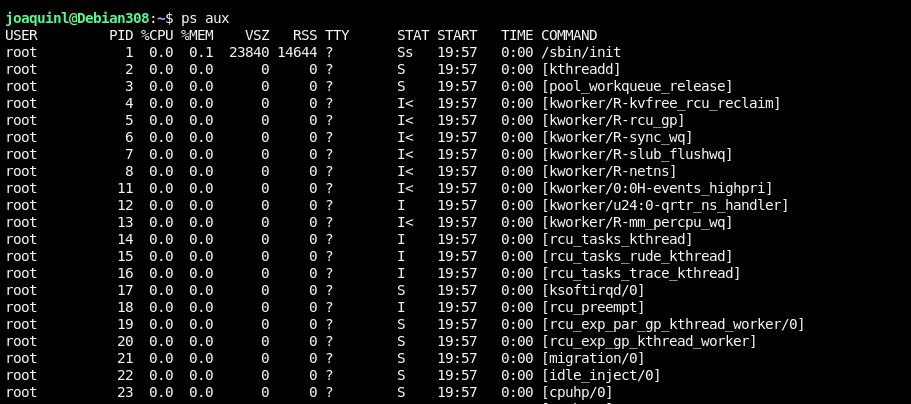
* **Interpretacion:** Detalla el PID, usuario, y consumo de recursos. Sirve para identificar servicios activos.

#### 2. top
* **Nombre y finalidad:** `top`. Monitoriza procesos en tiempo real ordenados por consumo de recursos.
* **Sintaxis y opciones:** `top [opciones]`
  * `-u [usuario]`: Filtra procesos por usuario.
  * `-d [segundos]`: Define el intervalo de actualizacion.
* **Captura de pantalla:**
  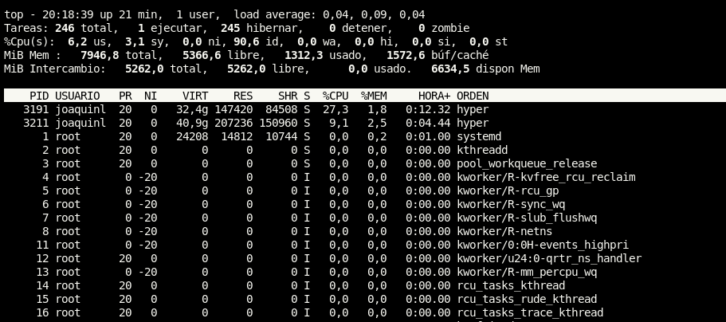
* **Interpretacion:** Muestra la carga del sistema y detecta que procesos consumen mas CPU.

#### 3. htop
* **Nombre y finalidad:** `htop`. Monitor interactivo de procesos con interfaz mejorada.
* **Instalacion:** `sudo apt install htop`
* **Sintaxis y opciones:** `htop [opciones]`
  * `-u [usuario]`: Filtra por usuario.
  * `-t`: Muestra procesos en vista de arbol.
* **Captura de pantalla:**
  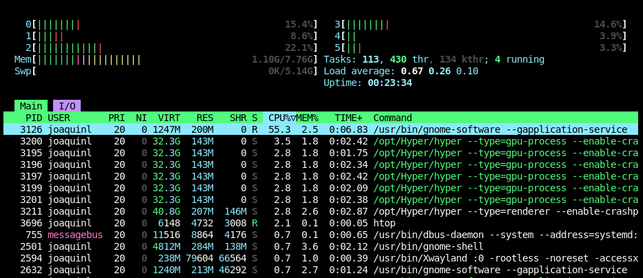
* **Interpretacion:** Facilita la gestion de procesos (cerrar o cambiar prioridad) usando graficos de barras.

#### 4. atop
* **Nombre y finalidad:** `atop`. Monitor avanzado que registra el uso historico de CPU, RAM, disco y red.
* **Instalacion:** `sudo apt install atop`
* **Sintaxis y opciones:** `atop [opciones]`
  * `-c`: Muestra el comando completo de cada proceso.
  * `-r [archivo]`: Lee datos desde un archivo de registro.
* **Captura de pantalla:**
  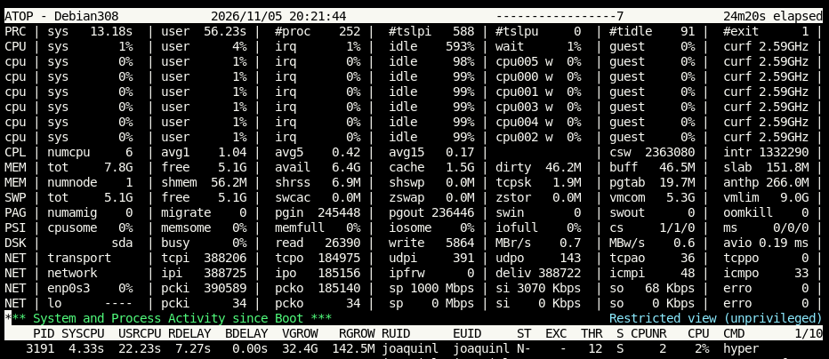
* **Interpretacion:** Resalta los recursos saturados. Ideal para realizar analisis de rendimiento profundo.

---

### 1.2 Memoria RAM

#### 1. free
* **Nombre y finalidad:** `free`. Muestra la memoria fisica y Swap libre, usada y disponible.
* **Sintaxis y opciones:** `free [opciones]`
  * `-h`: Muestra tamaños en formato legible (MB, GB).
  * `-s [segundos]`: Repite la ejecucion cada ciertos segundos.
* **Captura de pantalla:**
  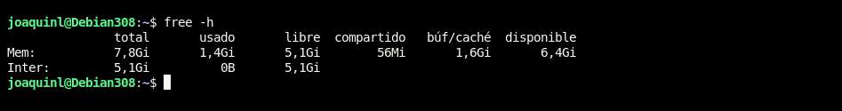
* **Interpretacion:** La columna "available" indica la RAM real disponible para nuevos procesos.

---

### 1.3 Almacenamiento

#### 1. df
* **Nombre y finalidad:** `df`. Muestra el espacio de almacenamiento usado y disponible en las particiones.
* **Sintaxis y opciones:** `df [opciones]`
  * `-h`: Formato legible (MB, GB).
  * `-T`: Muestra el tipo de sistema de archivos.
* **Captura de pantalla:**
  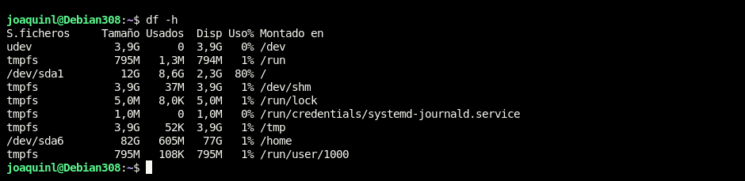
* **Interpretacion:** Permite controlar que particiones principales como `/` o `/var` no se llenen.

#### 2. du
* **Nombre y finalidad:** `du`. Calcula el espacio que ocupa un directorio o archivo especifico.
* **Sintaxis y opciones:** `du [opciones] [directorio]`
  * `-s`: Muestra solo el total resumido.
  * `-h`: Formato legible.
* **Captura de pantalla:**
  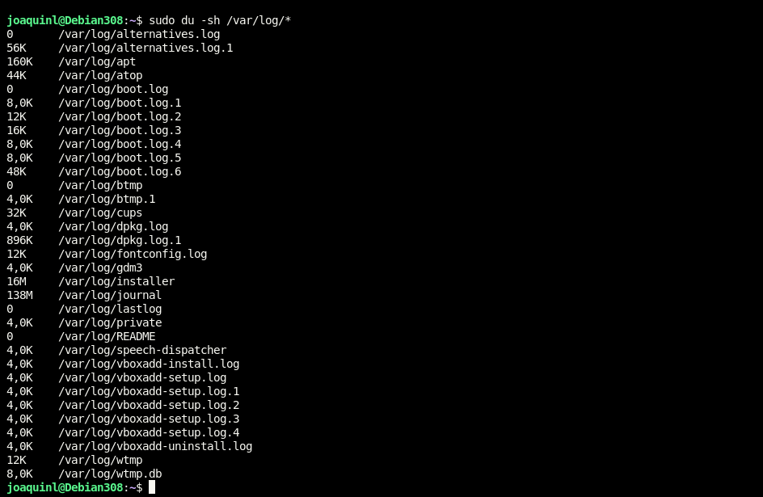
* **Interpretacion:** Localiza directorios pesados para liberar espacio.

#### 3. iostat
* **Nombre y finalidad:** `iostat`. Mide estadisticas de entrada y salida (I/O) de los discos.
* **Instalacion:** `sudo apt install sysstat`
* **Sintaxis y opciones:** `iostat [opciones]`
  * `-x`: Muestra estadisticas extendidas.
  * `-d`: Solo muestra el informe de discos.
* **Captura de pantalla:**
  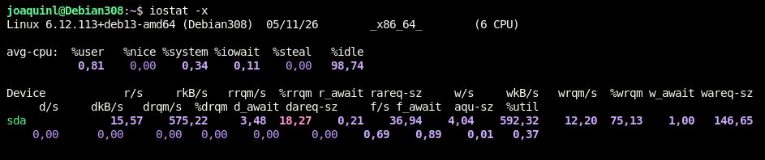
* **Interpretacion:** El valor "%util" indica si el disco sufre saturacion por alta demanda.

---

### 1.4 Trafico de Red

#### 1. tcpdump
* **Nombre y finalidad:** `tcpdump`. Analizador de paquetes de red desde la linea de comandos.
* **Instalacion:** `sudo apt install tcpdump`
* **Sintaxis y opciones:** `tcpdump [opciones]`
  * `-i [interfaz]`: Selecciona la tarjeta de red a capturar.
  * `-c [numero]`: Captura una cantidad exacta de paquetes.
* **Captura de pantalla:**
  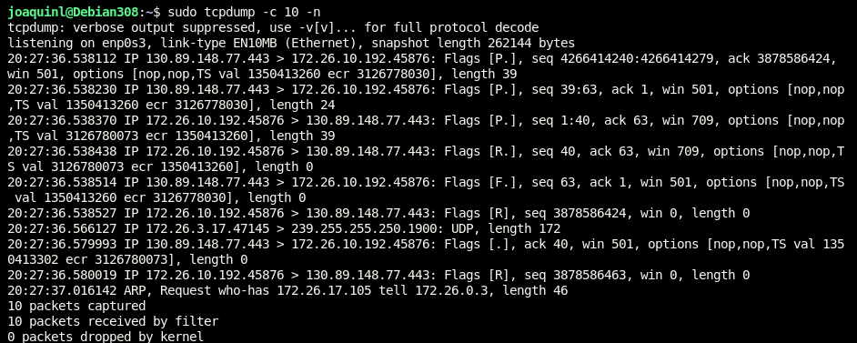
* **Interpretacion:** Captura trafico crudo para diagnosticar problemas de conexion o seguridad.

#### 2. tcptrack
* **Nombre y finalidad:** `tcptrack`. Muestra conexiones TCP activas y su consumo de ancho de banda.
* **Instalacion:** `sudo apt install tcptrack`
* **Sintaxis y opciones:** `tcptrack [opciones]`
  * `-i [interfaz]`: Interfaz de red a vigilar.
  * `-r [segundos]`: Tiempo para retener en pantalla conexiones cerradas.
* **Captura de pantalla:**
  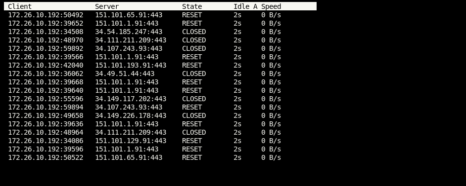
* **Interpretacion:** Monitoriza en tiempo real las conexiones activas y sus velocidades de transferencia.

#### 3. iptraf / iptraf-ng
* **Nombre y finalidad:** `iptraf-ng`. Monitor interactivo de red basado en consola.
* **Instalacion:** `sudo apt install iptraf-ng`
* **Sintaxis y opciones:** `sudo iptraf-ng [opciones]`
  * `-d [interfaz]`: Muestra estadisticas especificas de una interfaz.
* **Captura de pantalla:**
  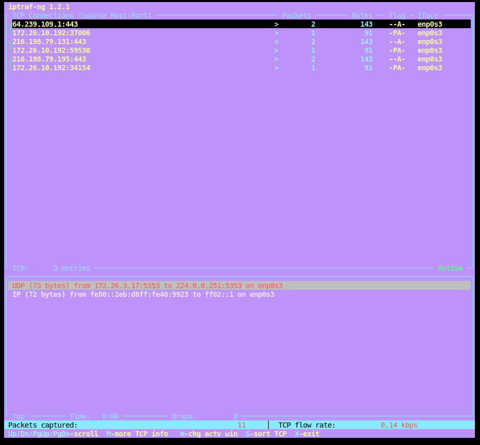
* **Interpretacion:** Proporciona metricas detalladas separadas por protocolo y puerto.

#### 4. bmon
* **Nombre y finalidad:** `bmon`. Monitor grafico de ancho de banda en terminal.
* **Instalacion:** `sudo apt install bmon`
* **Sintaxis y opciones:** `bmon [opciones]`
  * `-p [interfaz]`: Filtra la monitorizacion a una interfaz.
  * `-r [segundos]`: Intervalo de actualizacion de la grafica.
* **Captura de pantalla:**
  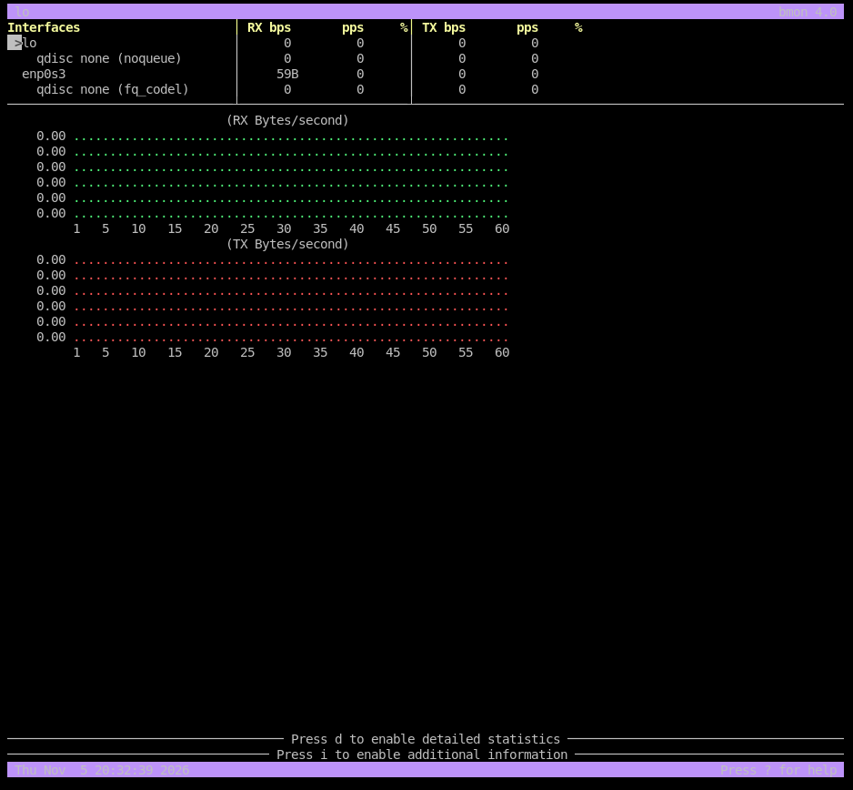
* **Interpretacion:** Representa visualmente el flujo de datos de entrada (RX) y salida (TX).

---

### 1.5 Puertos y Conexiones

#### 1. ss
* **Nombre y finalidad:** `ss`. Lista los puertos abiertos del sistema a la escucha.
* **Sintaxis y opciones:** `ss [opciones]`
  * `-t`: Muestra conexiones TCP.
  * `-u`: Muestra conexiones UDP.
  * `-l`: Filtra solo puertos escuchando (listening).
  * `-n`: Muestra formato numerico.
  * Comando normal: `ss -tuln`
* **Captura de pantalla:**
  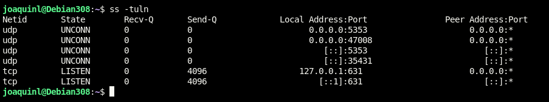
* **Interpretacion:** Verifica que los servicios del servidor estan levantados y operando correctamente.

#### 2. nmap
* **Nombre y finalidad:** `nmap`. Escaner de red para descubrir puertos y servicios en una IP.
* **Instalacion:** `sudo apt install nmap`
* **Sintaxis y opciones:** `nmap [opciones] [IP]`
  * `-p [puertos]`: Escanea puertos especificos (ej. `-p 80,443`).
  * `-sV`: Identifica versiones de los servicios detectados.
* **Captura de pantalla:**
  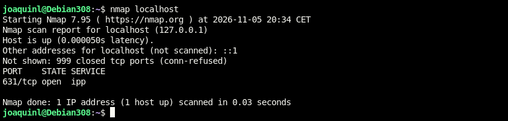
* **Interpretacion:** Evalua los puertos abiertos desde el exterior, util en auditorias de seguridad.

---

## 3. Analisis de Resultados

**1. ¿Como comprobarias la cantidad de memoria RAM disponible?**  
Ejecutando `free -h` y verificando el valor de la columna **"available"**.

**2. ¿Que diferencia existe entre df y du?**  
* `df` muestra el almacenamiento global de las particiones montadas.
* `du` mide el tamaño exacto que ocupan directorios y archivos especificos.

**3. ¿Que diferencias existen entre ss y nmap?**  
* `ss` revisa los puertos locales desde el interior del propio servidor.
* `nmap` escanea y audita los puertos desde el exterior de la maquina.

**4. ¿Como comprobarias si un servidor tiene abierto el puerto 80?**  
* Internamente: Ejecutando `ss -tuln | grep :80`.
* Externamente: Ejecutando `nmap -p 80 <IP_del_servidor>`.

**5. ¿Que herramienta utilizarias para detectar un posible cuello de botella en el disco?**  
Utilizaria **`iostat -x`**. Si el valor de `%util` se acerca de forma constante al 100%, indica saturacion en el disco.

**6. ¿Por que es importante monitorizar los recursos de un servidor?**  
Para prevenir caidas por agotamiento de recursos, planificar ampliaciones de hardware y detectar anomalias relacionadas con brechas de seguridad.
